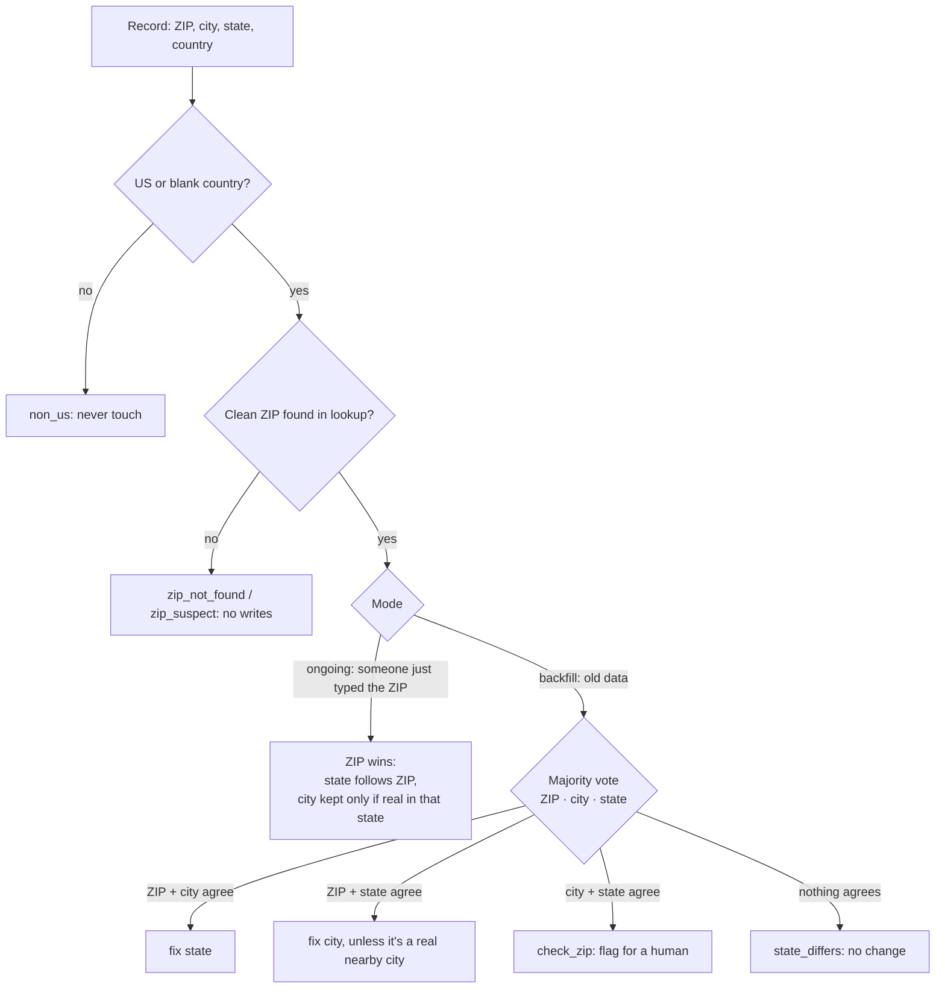

# HubSpot ZIP Data Quality

[](https://github.com/vrutikadani/hubspot-zip-data-quality/actions/workflows/ci.yml)

A HubSpot custom-code workflow action that fixes city and state using the ZIP code, on contacts, companies and deals. It runs every time someone types a ZIP, and in a one-time backfill that cleaned up years of messy address data.

> **About this repo.** I built and run this in production across six workflows (autofill and backfill × contacts, companies, deals). Territory routing, owner assignment and the public provider map all depend on clean state data, so this sits under everything else. This is a clean-room version with a small synthetic ZIP table.

## The business problem

- Reps and forms entered addresses every possible way: "Saint Louis" vs "St. Louis", ZIPs missing their leading zero after a spreadsheet import, a Dallas ZIP with state "OK".
- Owner assignment routes by ZIP, then by state. Bad state = wrong rep.
- A plain "overwrite city and state from the ZIP" rule would have broken good records too, because sometimes the ZIP is the wrong field.

## How it decides



| Status | Meaning |
|---|---|
| `ok` / `fixed` | Clean, or fixed in ongoing mode |
| `fixed_state`, `fixed_city`, `filled_blank` | Backfill corrections |
| `city_differs` | A real neighboring city with a matching ZIP and state: left alone |
| `check_zip`, `state_differs` | Not enough agreement: no change, review list |
| `non_us`, `no_country_unclean_zip`, `zip_not_found`, `zip_suspect` | Safety skips |

## Safety first

- **Dry run by default.** Every change is written to a `proposed` output first. I reviewed samples before turning writes on.
- **Never guesses.** If the three fields don't give a majority, nothing changes.
- **Non-US records are never touched.**
- **Repairs lost leading zeros** (`2108` → `02108`) only when the country is set, so a stray number isn't read as a ZIP.
- **Single file, all objects.** Field names per object live in one map (`FIELDS`), so the same code runs on contacts, companies and deals.
- **Rate limits re-thrown** so HubSpot retries them. Other errors are reported and nothing is half-written.

## Run it

```bash
node --test test/decide.test.js   # 12 tests, no dependencies
```

To deploy: create a workflow with a custom code action (Node 20), add the `HUBSPOT_TOKEN` secret, paste `src/decide.js` and `src/action.js`, and set outputs `status` and `proposed`. Host your ZIP lookup JSON in your file manager and set `ZIP_LOOKUP_URL`.

## Code map

| File | What it does |
|---|---|
| `src/decide.js` | Pure rules: ZIP cleaning, city normalizing, ongoing vs backfill decisions |
| `src/action.js` | HubSpot wrapper: read the record, decide, write (or dry-run), return outputs |
| `data/zip_lookup_sample.json` | Synthetic ZIP → city, state, alternate names |
| `test/decide.test.js` | Every rule and every safety skip |

